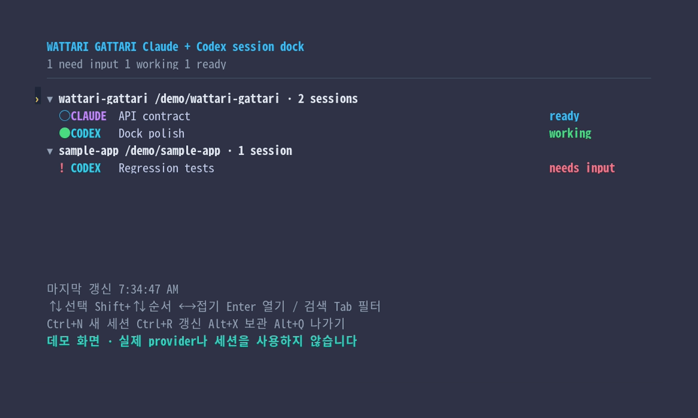

# Wattari Gattari

[](https://github.com/dkwlsdl3/wattari-gattari/actions/workflows/ci.yml)
[](LICENSE)

[English](README.md) · [아키텍처](docs/adr/README.md) · [라이선스](LICENSE)

Wattari Gattari(`waga`)는 Claude Code와 Codex의 활성 세션을 한 dock에서 열고
연결하는 로컬 CLI와 웹 작업실입니다. 실제 세션 실행과 승인 화면은 provider가 소유합니다.



## 핵심 기능

- 프로젝트별 세션 탐색과 네이티브 TUI 연결
- 검색·필터·수동 정렬·이름 변경·생성·보관
- Claude·Codex 사용 한도 표시 (5분 캐시)
- 넓은 화면에서 선택한 세션의 마지막 입력·응답 미리보기
- `waga send` 단방향 알림과 `waga ask` 응답 요청

## 요구 사항과 설치

- Linux, Node.js 22 이상
- Agents 기능을 지원하는 Codex CLI와 Claude Code
- 선택 사항: 화면 재사용과 공유를 위한 tmux

provider 업데이트 뒤에는 `waga doctor`로 연결 환경을 확인하십시오.

```bash
git clone git@github.com:dkwlsdl3/wattari-gattari.git
cd wattari-gattari
npm install
npm link
waga doctor
```

이 프로젝트는 npm에 배포하지 않습니다.

## 빠른 시작

```bash
waga                            # 모든 프로젝트의 통합 dock
waga --cwd ~/work/my-app        # 한 프로젝트로 제한
waga --backend direct           # tmux 없이 실행
waga --backend tmux             # tmux backend 필수
waga list --provider claude
waga list --json
waga serve                      # 로컬 브라우저 작업실

waga send codex:<thread-id> "ADR을 확인해 주세요"
waga ask claude:<session-id> "현재 API 계약을 검토해 주세요"
waga ask codex:<thread-id> "전체 검증을 수행해 주세요"
waga open codex --cwd ~/work/my-app
```

`waga agents`는 `waga list`의 별칭입니다. 대상은 `claude:<id>` 또는
`codex:<id>`처럼 provider 접두사가 붙은 ID를 권장합니다.

### 웹 작업실

`waga serve [--port 4317] [--cwd PATH]`를 실행하고 출력된 접속 링크를 여십시오.
서버는 `127.0.0.1`에만 바인딩하며, 링크의 비밀값으로 인증한 뒤 HttpOnly 쿠키를 사용합니다.
비밀값은 주소창에서 제거됩니다. 서버 재시작 후에는 새 접속 링크가 필요합니다.

기본 **실행 그래프** 화면은 Claude Code OTLP JSON 기록을 가져와 실제 메인·에이전트
호출 관계와 선택한 도구의 출력·diff를 보여줍니다. `waga run`으로 시작한 실행은
실시간 추적과 명시적 작업 의존성, 검사·독립 검증·재시도 결과를 함께 표시합니다. 호출 종료만으로 통과시키지 않습니다. [기록 형식과 검증 범위](docs/web-executions.md)를 참고하십시오.
실행 방법과 제한은 [로컬 워크플로 실행](docs/web-executions.md#로컬-워크플로-실행)을 참고하십시오.
아래 작업 단계·대화 기능은 **세션 대화**에서 사용합니다.

- 작업별 요구 확인 → 구현 → 검증 → 독립 리뷰 → 통합 그래프와 단계별 담당 세션 연결
- 상단의 작업 단계 선택 → 중앙의 넓은 세션 대화, 중복 응답 없이 표시
- Enter로 전송, Shift+Enter로 줄바꿈, 응답 대기 중 다음 메시지 초안 작성
- 실패 시 이전 단계로 복귀하고 후속 근거 무효화, SHA 변경 시 검증·리뷰·통합 재확인
- 단계에 새 세션 연결: 지정한 작업 폴더에서 provider 기본 모델·승인 정책 사용 (LLR 호출 없음)
- Codex 세션의 **작업 지시**: 실제 사용자 입력으로 전달하여 파일 수정·명령 실행 요청, 기존 세션의 승인·샌드박스 정책 유지
- **에이전트 질의**: 기존 `ask`의 불신 peer 메시지 계약 유지. 기존 Claude 연결은 이 방식만 지원하며 작업 지시로 표시하지 않음
- 늦은 답변은 해당 단계의 **답변 다시 확인**으로 같은 요청만 조회하며 재전송하지 않음

**＋ 작업**으로 작업을 등록하고 각 단계에 기존 세션을 연결하거나 새 세션을 만듭니다.
단계 상태는 **단계 상태·근거** 버튼에서 직접 기록합니다. 통과에는 근거가 필요하고,
검증·리뷰·통합에는 현재 저장소에 존재하는 전체 커밋 SHA가 필요합니다. 근거는 사용자가
기록한 결과이며 Waga가 테스트·CI·리뷰를 자동 검증했다는 뜻이 아닙니다. 독립 리뷰를 구현과
같은 세션에 연결한 경우 통과할 수 없습니다. 되돌리기·담당 세션 교체는 후속 근거를 무효화합니다.

작업 그래프·담당 세션·완료 근거·단계별 최근 질의 5건(답변 각각 최대 4,000자)은
`$XDG_STATE_HOME/wattari-gattari/workflows`에 비공개 파일로 저장하며 재시작 후 유지합니다.
기존 기록에서 작업 역할을 추정하거나 자동 실행·재시도·통합하지 않습니다. 현재 단계 구성은
요구 확인 → 구현 → 검증 → 독립 리뷰 → 통합이며 임의 DAG 편집기는 아닙니다.

브라우저를 닫아도 서버와 native 작업은 계속됩니다. 전체 대화를 복제하지 않으며,
최근 입력·응답 각각 최대 4,000자와 조회 범위 제한을 표시합니다.
초안은 단계·수신 세션별로 브라우저 localStorage에 저장해 새로고침 후 복원합니다. 보낸 본문의 임시 표시는 현재 페이지에만 남습니다. 목록·미리보기는
5초 캐시하고 숨긴 탭은 갱신하지 않습니다. 전체 요청 타임라인은 화면에 표시하지 않습니다.

네트워크 오류나 서버 종료 직후에는 전달 여부가 미확정일 수 있습니다. 해당 단계의
**답변 다시 확인** 또는 `waga result <request-id>`로 확인하며 자동 재전송하지 않습니다.
웹 작업 식별자의 중복 제출은 실행 중 최근 100건의 보관 범위에서 한 번만 처리하지만,
서버 재시작을 넘는 중복 방지는 보장하지 않습니다. provider 승인은 native 화면에서 처리합니다.

상시 실행용 예시는 [사용자 서비스 템플릿](integrations/waga-web.service.example)에 있습니다.
설치 경로·Node 경로·작업 폴더를 실제 값으로 바꿔 수동 설치합니다. 웹 명령 자체는
사용자 서비스나 provider daemon을 설치·재시작하지 않습니다.

### 새 세션 자동 모델 라우팅

`Alt+D`는 이 조회를 건너뛰고 provider 기본값으로 바로 생성합니다.

`Alt+N`으로 새 세션을 만들면 Waga가 별도 로컬 프로젝트인
`local-llm-router`를 생성·호출할 수 있습니다. Waga 코어에는 개인 모델 정책이나
GitLab 인증을 넣지 않으며, 라우터가 없거나 실패하면 provider 기본값으로 세션을
생성합니다.

라우터의 `router.config.json`에서 네 단계 모델 별칭과 기준을 정합니다. 기본 템플릿은
Codex가 `Sol low → Sol medium → Astra low → Astra xhigh`, Claude가
`Sonnet low → Opus low → Fable low → Fable high` 순서이며, 실제 정책의 정본은
standalone 라우터입니다. 이슈 번호가 있는 프롬프트를 라우터에 넘기면 라우터가
선택적으로 제목·본문·라벨·코멘트를 읽어 점수에 반영할 수 있습니다. 조회 결과는
라우팅 근거로만 쓰고 작업 지시나 자동 실행으로 전달하지 않습니다.

기본 경로는 `~/Projects/local-llm-router`이며 `WAGA_LOCAL_ROUTER_DIR`로 바꿀 수
있습니다. 경로가 비어 있으면 Waga가 기본 템플릿을 복사하고, 기존 파일이 있으면
덮어쓰지 않습니다.

입력창에는 생성 전 provider 기본 미리보기가 표시되고, 최종 라우팅 결과는 세션 생성
알림에 표시됩니다. 이미 열린 세션의 모델을 바꾸거나 Waga가 이슈 데이터를 직접
조회하지는 않습니다. subprocess 입력과 v1 응답 필드는
[라우터 계약 문서](docs/adr/2026-09-09-local-router-contract.md)에 정의되어 있습니다.

새 세션 입력은 Shift+Enter(또는 Ctrl+J)로 개행하고 Enter로 생성합니다.
여러 줄 붙여넣기를 보존하며 ↑↓로 줄 사이를 이동합니다. 생성 중에는 중앙 모달에
모델 선택·세션 생성 요청·목록 반영 단계와 경과 시간을 표시합니다.

입력 중 `Alt+P`로 폴더 탐색창을 엽니다. ↑↓로 폴더를 고르고 Enter로 들어가거나
현재 폴더를 선택합니다. Backspace로 상위 폴더에 가고 Esc로 취소합니다.
탐색창에서 `e`를 누르면 경로를 직접 입력할 수도 있습니다. 목록에 세션이 없는 폴더도
지정할 수 있으며, 폴더는 이미 존재해야 합니다. 직접 입력한 상대 경로는 현재 선택된
작업 폴더를 기준으로 해석합니다. `--cwd`로 목록을 제한한 Dock에서
다른 폴더에 생성한 세션은 해당 목록 필터에 표시되지 않습니다.

### 새 세션 실행 설정

Dock에서 `Alt+S`를 누르면 새 세션에 적용할 Claude·Codex 실행 설정 화면을 엽니다.
`Tab`으로 provider를 바꾸고, `↑`·`↓`로 항목을 고른 뒤 `Space`로 선택합니다.
라디오 그룹은 하나만 선택되고 체크박스 그룹은 여러 항목을 선택할 수 있습니다.
`Enter`는 저장, `Esc` 또는 `Alt+S`는 취소입니다.

- Claude: 승인 권한(`default`, `manual`, `acceptEdits`, `auto`, `dontAsk`, `plan`,
  `bypassPermissions`)과 `dangerously-skip-permissions`, `restricted`, `bare`,
  `disable-slash-commands`, `strict-mcp-config` 실행 옵션을 설정합니다.
- Codex: 승인 정책(`default`, `untrusted`, `on-request`, `never`, `granular`),
  샌드박스(`default`, `read-only`, `workspace-write`, `danger-full-access`), 승인
  검토자, 응답 요약 수준, 세부 승인 항목과 provider 모델 대체 허용을 설정합니다.

Waga는 선택한 값을 새 세션 생성 시 Claude CLI의 실행별 플래그와 Codex App Server의
`thread/start`·첫 `turn/start` 파라미터로 전달합니다. provider의 native 승인 화면과
실행은 각 provider가 계속 소유합니다. `Alt+Y`는 Codex의 기본값과 YOLO
(`approvalPolicy=never` + `sandbox=danger-full-access`)를 빠르게 전환하는 호환
단축키입니다.

설정은 `$XDG_CONFIG_HOME/wattari-gattari/settings.json`(기본값
`~/.config/wattari-gattari/settings.json`)의 version 2 문서에 저장됩니다. 기존
version 1 Codex 전환 설정은 읽을 때 provider 설정으로 변환되며, 파일이 없거나
읽을 수 없으면 provider 기본값으로 닫힙니다. 기존 세션과 `send`·`ask`에는 영향을
주지 않고, 다음에 만드는 Claude·Codex 세션부터 적용됩니다.

## Dock 조작

120열 × 20행 이상이면 오른쪽에 최근 대화를 표시합니다. 선택 후 150ms를 기다려
해당 세션만 조회하고 5초 캐시하며, dock이 숨겨지면 조회하지 않습니다.
긴 기록은 일부만 표시하며 터미널 화면 복제는 아닙니다. 마지막 응답은 이전 입력의
응답일 수 있습니다. 오른쪽 응답이 길면 `PgUp`·`PgDn`으로 선택을 바꾸지 않고
응답 영역만 페이지 단위로 스크롤할 수 있습니다. 추가 모델 호출이나 별도 대화 로그
저장은 없습니다.

| 키 | 동작 |
|---|---|
| `↑` / `↓` | 이동 |
| `Shift+↑` / `Shift+↓` | 세션 표시 순서 변경 |
| `←` / `→` / `Enter` | 프로젝트 접기·펼치기 |
| 세션에서 `Enter` | 실행 중인 네이티브 TUI로 복귀 |
| 세션에서 `F4` | 네이티브 TUI 강제 재접속 |
| `/` / `Tab` | 검색 / provider 필터 |
| `F2` | 선택한 세션 이름 변경 |
| `Alt+N` / `Alt+R` | 새 세션 / 새로고침 |
| `Alt+D` | local-llm-router를 거치지 않는 provider 기본값 새 세션 (편집 중 `Alt+D`로 전환) |
| `Alt+S` | 새 세션 Claude·Codex 실행 설정 |
| `Alt+Y` | 새 Codex 세션 실행 모드 기본값 / YOLO 전환 |
| `Alt+X` 두 번 | 세션 보관 |
| `Alt+Q` | Waga 종료 |
| `PgUp` / `PgDn` | 오른쪽 선택 응답만 페이지 단위로 스크롤 |

기본 `auto`는 tmux가 있으면 세션 창을 재사용하고, 없으면 `direct`로 실행합니다.
여러 터미널에서 `waga`를 실행하면 각각 목록과 에이전트 화면을 독립적으로 선택합니다.
동일한 에이전트 창을 열면 그 창의 화면과 입력은 공유합니다. 한쪽 Waga를 닫아도
다른 화면과 보관된 에이전트 창은 유지됩니다. 변경은 새로 실행한 Waga부터 적용됩니다.
네이티브 화면에서 돌아오는 키는 다음과 같습니다.

- Waga 격리 tmux: `Alt+G`로 dock, `Alt+A`로 별도 provider Agents View
- 기존 tmux 안: prefix 뒤 `0`으로 dock
- direct: Claude `Ctrl+Z`, Codex `Ctrl+D`로 native view 종료·분리

Claude `←`나 Codex `/agents`로 내부 이동해도, dock에서 다시 선택하면 해당 세션으로
연결합니다. 창 재사용 판정은 [ADR](docs/adr/README.md)에 있습니다.

- **이름 변경:** Codex는 즉시, Waga에서 만든 훅 지원 Claude 세션은 다음 프롬프트 때
  한 번 반영합니다. 훅 없는 Claude 세션은 로컬 별칭이며 저장 안내로 구분합니다.
- **보관:** 대화 로그는 남깁니다. Codex는 archived sessions로 옮기고,
  Claude는 background job과 관리 worktree를 정리합니다.

Codex 0.153.4의 재접속 화면이 예전 출력으로 덮이면 `/raw on`으로 우회할 수 있습니다.
서식만 단순해지고 로그는 유지됩니다. 새 TUI에서는 다시 필요할 수 있으며,
Waga가 다른 세션의 표시 모드나 전역 설정을 바꾸지는 않습니다.

## 세션 간 메시지

- `send`: 단방향 알림. 제출만 확인합니다.
- `ask`: Claude는 작업 중에도 native peer 큐에 넣고 요청 ID가 붙은 답변을 기다립니다.
  Codex는 Waga 호출끼리 접수 순서대로 기다린 뒤 대상이 idle이면 peer turn을 제출하고,
  그 turn이 완료되면 마지막 답변을 반환합니다. 두 provider 모두 요청에 연결된 답변을
  받으면 질의가 끝나며, 상대가 다른 작업을 계속하는지는 완료 조건이 아닙니다.
- `--until-idle`은 오래된 세션·스크립트와의 호환을 위해 허용합니다.
  별도의 세션 idle 대기를 추가하지 않으며 새 호출에는 생략합니다.
- `ask --notify-origin`: Claude Code 세션에서 실행한 `ask`가 답을 받으면 원래 세션에
  요청 ID와 답변을 native 메시지 한 건으로 알립니다. 백그라운드 호출과 `--until-idle`을
  함께 쓸 때도 답변 도착 시점에 알립니다.
  긴 답변은 앞부분만 보내고 전체 답변은 `waga result <request-id>`로 읽습니다.
  원래 세션의 메시지 소켓이 없는 환경에서는 이 옵션을 사용할 수 없습니다.

진행 출력에는 요청 UUID와 전송 상태가 함께 나옵니다.

| 상태 | 의미 |
|---|---|
| `not-sent`, `waiting-local`, `waiting` | 미전송. 각각 준비, Waga 대기열, 대상 busy 대기 |
| `submitting` | 제출 중. 연결 종료 시 전달 여부 불명 |
| `submitted` | 제출됨. Claude는 수신 확인 전, Codex는 native 제출 확인 |
| `accepted` | Claude가 접수를 확인함. 작업 완료는 아님 |
| `reply-received` | 요청에 연결된 답변 수신. 세션 idle 대기 없음 |
| `working` | 요청 turn의 완료 답변을 아직 기다리는 중 |
| `replied` | 요청에 연결된 답변 반환 |

장시간 검증에는 시간 제한을 명시합니다. Codex의 기본 전송 전 대기는 1800초,
제출 후 답변 대기는 180초입니다. Claude의 `--wait-timeout`은 전송 전 대상 확인에만
사용하며, 큐에서 기다리는 시간도 `--reply-timeout`에 포함됩니다.

```bash
waga ask codex:<thread-id> "현재 변경을 검증해 주세요" --wait-timeout 1800 --reply-timeout 1800
waga ask claude:<session-id> "결과를 알려 주세요" --notify-origin --reply-timeout 1800
waga result <request-id> --json
```

`result`는 재전송하거나 다른 turn을 따라가지 않습니다. Claude 답변이 저장된 오래된
`reply-received` 기록도 세션 접속 없이 반환하며, 일반 출력·JSON 모두 답변을 제공합니다.
호출 중단은 미전송을 뜻하지 않습니다. 출력된 요청 ID로 회수합니다. 답변을 회수하거나
단방향 `send`의 접수를 확인하면 종료 코드 0,
대기·미전송·결과 미확정·중단 상태면 3, 조회 자체가 실패하면 1입니다.
`ask`/`send` 오류는 종료 코드 1이며 요청 ID와 전달 상태를 출력합니다.
파이프로 출력할 때는 `set -o pipefail`을 사용해야 `tail` 등의 성공이 실패를 가리지 않습니다.

요청 메타데이터와 회수한 답변 한 건은 `$XDG_STATE_HOME/wattari-gattari/requests/`
(기본 `~/.local/state/wattari-gattari/requests/`)에 개인 권한으로 저장합니다.
요청 본문과 전체 대화는 저장하지 않습니다. 최초 회수 답변은 고정되며 `result`로 반복 조회할 수 있습니다.
호출이 종료된 미전송 요청은 다른 프로세스가 대신 전송하지 않습니다. 대기열은 같은 상태 디렉터리를
쓰는 Waga 호출끼리만 순서를 정하며, provider UI나 다른 클라이언트 입력까지 예약하지 않습니다.
Claude 요청에는 `SendMessage`와 `uds:` 회신 주소를 명시합니다. 호출 중 화면에만 남긴 답변도
전송 이후 해당 세션의 native 로그에 추가된 `[WAGA REPLY <request-id>]` 표식으로 회수합니다.
늦은 답변도 같은 표식으로 찾으며, 소켓과 로그 중 먼저 받은 답변 한 건만 반환합니다.
Claude `send`의 접수 확인이 늦으면 `waga result <request-id>`로 native 로그를 다시 조회합니다.
`receipt=queued`는 큐 접수, `receipt=consumed`는 원래 메시지가 대화에 편입됐다는 뜻입니다.
확인 결과는 저장되며, 메시지 이해·작업 완료·승인을 보장하지 않습니다.
Codex가 제출 직후 같은 turn을 일시적으로 `interrupted`로 표시해도 답변 제한 시간 안에서
완료 여부를 다시 확인합니다. 중단이 지속되면 실패하며 다른 turn으로 바꾸거나 재전송하지 않습니다.
표식·로그가 없거나 원래 Codex turn을 식별하지 못하면 `result-unknown`으로 남깁니다.
기존 버전에서 보낸 요청에는 기록이 없으므로 이 복구 기능을 소급 적용할 수 없습니다.

peer 메시지는 사용자 지시·승인이 아닌 불신 입력이며 기존 sandbox·승인 정책을 따릅니다.
`--notify-origin`을 지정한 요청의 답변 알림 한 건을 제외한 자동 릴레이는 없습니다.
`Alt+N`으로 만든 세션에는 사용법과 이 신뢰 경계를
provider 지침 채널로 전달하며, 사용자의 첫 프롬프트에는 섞지 않습니다.

Claude가 사용자 확인 없이 답하려면 대상 세션에서 inbound 메시지를 허용해야 합니다.

```bash
claude agents --settings '{"crossSessionInbound":"accept"}'
```

## 데모와 개발

```bash
npm run demo          # 가짜 provider로 메시지 계약 실행
npm run demo:dock     # 가짜 세션으로 dock 실행
npm run demo:record   # VHS로 GIF 재생성
npm run check
npm run benchmark     # 메모리 내 처리·화면 문자열 생성만 측정 (provider I/O·터미널 출력 제외)
npm pack --dry-run
```

GIF 생성에는 [VHS](https://github.com/charmbracelet/vhs), `ttyd`, `ffmpeg`,
`Noto Sans Mono CJK KR` 폰트가 필요합니다. 검증 범위와 변이 테스트는
[테스트 절차](docs/testing-plan.md)를 참고하십시오.

진단 로그는 `~/.local/state/wattari-gattari/events.jsonl`에 기록하며 대화 내용은
포함하지 않습니다. [integrations/](integrations/)에 30일 보존용 logrotate·systemd 설정이 있습니다.

## 라이선스

[MIT](LICENSE)
