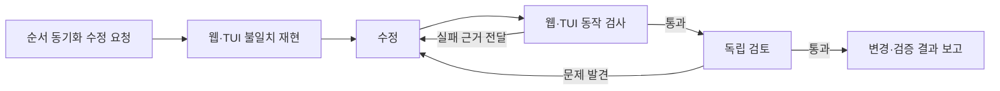

# 작업 단위 실행 관리 설계 정본

- 상태: 채택 — 제품 방향과 구현 기준. 구현 완료 선언이 아닙니다.
- 결정일: 2026-10-16
- 근거: 같은 날 사용자가 요청한 다섯 엔지니어링 기법 조사와 Waga 개선 제안을
  사용자가 “위 내용을 설계정본으로 문서로 남겨”라고 승인한 대화.
- 적용 범위: Waga 웹 UI, 세션 간 작업 연결, 컨텍스트 인계, 작업 실행·검증·복구.

## 작업을 시작하거나 압축 후 재개할 때

1. 이 문서에서 작업의 목적·제품 경계·우선순위를 확인합니다.
2. `git status`, 관련 diff·커밋, `TODO.md`에서 실제 구현과 남은 작업을 확인합니다.
   이 문서의 목표 기능을 현재 기능이라고 보고하지 않습니다.
3. 수정할 경로의 호출자·저장값·API·UI와 관련 테스트를 따라가며 기존 동작을 확인합니다.
4. 아래 우선순위에서 이번 요청에 해당하는 범위와 실제 동작의 완료 조건을 정합니다.
   이미 허용된 작업은 진행하고, 별도 확인은 저장소의 기존 권한 경계를 따릅니다.

이 문서는 제품 방향의 단일 정본입니다. 실행 계약은 [ADR 안내](README.md),
검증 절차는 [테스트 문서](../testing-plan.md), 활성 작업은 [TODO](../../TODO.md)에 둡니다.
방향을 바꾸는 후속 사용자 결정은 이 문서에 반영하고 관련 포인터를 유지합니다.
현재 구현 상태나 완료 목록을 별도 문서에 복제하지 않습니다.

## 목적과 제품 경계

사용자 지시가 어떤 자료를 바탕으로 누구에게 전달됐고, 무엇을 바꿨으며,
어떤 동작 검사로 확인됐는지를 Claude·Codex 세션에 걸쳐 추적하고 실행을 관리합니다.
성공 기준은 실제 작업의 품질과 사용자가 다시 설명·확인해야 하는 부담의 감소입니다.

Waga는 작업 메타데이터·명시적인 실행 계획·산출물 참조·검증 근거를 관리합니다.
provider daemon·네이티브 세션·권한 집행·원본 대화 기록의 소유권은 provider에 남습니다.
대화 전체를 별도 저장소에 복제하기보다 원문 위치와 작업에 필요한 인계 정보를 연결합니다.
기존 사용자 세션의 조회·직접 지시와 Waga가 명시적으로 시작한 자동 실행은 구분합니다.
관측만 하는 세션의 도구·비용·내부 컨텍스트를 Waga가 전부 통제한다고 주장하지 않습니다.

사용자의 실행 허용 범위 안에서 자동 진행합니다. peer 답변이나 수집한 로그는 실행·승인
권한이 되지 않으며, 자동 루프를 무제한 peer 릴레이로 구현하지 않습니다.
머지·배포·기존 세션 중단 등 외부 부작용은 기존 저장소 계약을 따릅니다.
이번 설계 채택은 구현이나 실제 세션 조작을 이미 수행했다는 뜻이 아닙니다.

## 다섯 기법의 적용

다섯 항목은 서로 겹치는 설계 관점입니다. 각각 별도 화면이나 강제 실행 단계로 만들지 않습니다.

| 관점 | Waga의 책임 | 확인할 수 있어야 하는 것 |
|---|---|---|
| 프롬프트 | 원래 지시와 후속 변경, 범위·완료 조건·제약 연결 | 사용자가 요청한 것과 Waga가 추가로 해석한 조건 |
| 컨텍스트 | 필요한 대화·문서·코드·결정을 출처와 함께 선택·인계 | 무엇을 어떤 버전·시점의 자료에서 전달했는지 |
| 하네스 | 제공자 연결, 실행 환경, 격리, 자원 제한, 상태 저장·복구 | 누가 어디에서 실행 중이고 멈추면 어떻게 회수하는지 |
| 루프 | 실행 결과 확인, 수정·복구·대기 분기와 중단 조건 | 무엇이 실패했고 다음 시도가 무엇을 개선하는지 |
| 그래프 | 작업의 선행 조건·산출물 전달·검증 관계와 실행 순서 | 무엇 때문에 막혔고 어떤 결과가 다음 작업을 여는지 |

### 사용자 지시와 작업 식별

사용자는 기존 대화 입력창에서 지시합니다. 원문을 보존하고 후속 변경 지시를 연결합니다.
작업에 담당 세션·작업 폴더·참고 자료·수정 파일·커밋·검사 결과·남은 문제를 연결합니다.
작업, 개별 전달 요청, native turn/message, 실행 시도는 서로 다른 단위로 식별합니다.
접수·응답·세션 idle을 작업 완료로 바꾸지 않습니다.

프롬프트 보완으로 사용자 요청을 덮어쓰지 않습니다. 추론한 범위·조건은 원문과 구분하고,
사용자의 후속 정정이 관련 계획·자료·검증 조건에 반영되도록 합니다.
사용자에게 매번 긴 구조화 양식을 작성시키지 않습니다.

### 컨텍스트와 인계

작업별 인계는 현재 목표, 지켜야 할 결정, 출처가 있는 확인 사실, 미확인 사항,
다음 작업을 포함합니다. 파일 경로·커밋·원문 메시지 위치로 근거를 다시 읽을 수 있게 합니다.
사용자 선호, 프로젝트 규칙, 이번 작업의 임시 판단을 구분합니다.
자료의 관측 시점·버전·변경 여부를 보존하고 필요한 원문을 그때 읽습니다.
요약은 원문의 대체 증거가 아니며, 모델이 추가한 해석은 사실과 구분합니다.

Waga가 전달한 추가 자료와 provider가 공개한 정보까지 추적합니다.
기존 native 세션의 실제 내부 컨텍스트 전체를 안다고 표시하지 않습니다.
새 세션이나 압축 후에도 결정과 미해결 사항을 이어받되 과거 대화를 통째로 주입하지 않습니다.

### 실행과 복구

공통 작업 계약 아래 Claude·Codex의 공식 실행 경계를 어댑터로 연결합니다.
단계별 제공자는 달라도 작업 상태·입출력·검증 근거의 의미는 같아야 합니다.
provider별 권한·승인 경로를 유지하고, 기능 차이를 숨긴 성공 처리로 메우지 않습니다.
수정은 적절한 격리 작업 공간에서 수행하고 검증된 산출물만 다음 작업에 전달합니다.

웹 서비스의 수명과 작업 실행기의 복구는 별개로 설계합니다.
실행 상태와 단계별 결과를 저장하고 재시작 시 소유 프로세스·native 요청·산출물을 먼저 대조합니다.
불확실한 전달은 회수·확인 대상으로 남기며 자동 재전송하지 않습니다.
검증된 완료 단계는 재실행하지 않고, 남은 단계는 기존 작업을 중복 생성하지 않도록 재개합니다.
잠금 복구는 소유 프로세스가 실제로 끝났다는 확인을 전제로 합니다.

자원 제한은 작업 시작 전과 실행 중에 적용합니다. CPU·메모리 여유가 부족하면 새 작업을
대기시키고, 실행 중 보호 조치는 Waga가 소유한 작업에 한정합니다.
시간·시도·보고된 비용의 한도를 두며, 청구액이나 수집할 수 없는 사용량을 정확한 값으로
단정하지 않습니다. 자원 대기 중에는 불필요한 모델 호출을 만들지 않습니다.

### 실제 동작 검증과 루프

완료 조건은 사용자가 요구한 동작으로 정합니다. 검사 결과에는 대상 코드 버전,
환경·시각·검증 범위·결과를 연결합니다. 산출물이 바뀌면 이전 검증 결과의 유효성을 재평가합니다.
호출 종료·모델의 완료 주장·테스트 개수만으로 완료를 선언하지 않습니다.

| 사례 | 필요한 동작 근거 |
|---|---|
| 세션 순서 변경 | 웹 드래그 결과가 TUI와 재접속 후에도 유지됨 |
| 실시간 갱신 | 작업 중 응답이 해당 과제에서 정한 지연 기준 안에 반영됨 |
| 승인 선택 | 현재 질문과 정확한 세션에만 입력되고 질문 변경 시 오래된 선택이 거부됨 |
| 터미널 공유 | 웹 연결·해제가 기존 TUI의 크기와 출력을 훼손하지 않음 |

작업자와 검토자의 결론을 구분하고, 필요한 과제에는 독립 검토와 실제 브라우저·터미널
검사를 연결합니다. 파일 읽기만 한 검토를 실제 사용 검증으로 보고하지 않습니다.
완료 보고에는 확인된 결과와 아직 검증하지 않은 범위를 함께 남깁니다.

실패는 원인에 맞게 처리합니다. 코드 결함은 근거를 전달해 수정하고,
일시적인 연결 장애는 제한적으로 복구하며, 권한 대기는 해당 사용자 판단을 기다립니다.
전달 여부가 불명확하면 먼저 원래 요청을 회수합니다.
진전 없는 반복은 중단·재계획으로 전환하며, 단순 파일 변경 유무만으로 진전을 판단하지 않습니다.
시도 한도와 진행 판정의 구체적인 값은 과제별 실행 정책과 검증 근거로 정합니다.

### 작업 그래프와 호출 기록

노드는 의미 있는 작업, 선은 선행 조건·산출물 전달·검증 등의 관계를 표현합니다.
노드에서 관련 대화·diff·검사·검토 결과로 이동할 수 있어야 합니다.
대기에는 막힌 원인, 통과에는 대상과 확인 근거를 연결합니다.
관계가 실행 순서를 제어하는 기능과 기록을 탐색하는 기능의 범위를 명확히 합니다.

관계의 근거를 구분합니다. 선언된 작업 의존성, 관측한 native 호출 관계,
LLM이 제안한 관계는 같은 확정 정보가 아닙니다. 시간순 나열만으로 인과관계를 만들지 않습니다.
LLM은 작업 분해·관계 제안·요약을 맡고, 코드는 명시적 ID·산출물·의존성 검증,
상태 전환·중복 방지를 맡습니다. 모델의 내부 사고를 추적했다고 표현하지 않습니다.

아래는 순서 동기화 수정 과제의 예시입니다. 모든 과제에 고정하는 단계가 아닙니다.

### 화면과 조작

왼쪽 폴더·세션 목록과 가운데 대화를 기본으로 유지합니다.
사용자 지시 메시지에서 해당 작업의 진행·결과를 열고, 기존 실행 흐름 탭에서 관계를 확인합니다.
세부 명령·식별자·긴 로그는 해당 작업에서 펼쳐 읽게 합니다.
작업 선택을 위해 폴더·세션 선택 구조를 다시 중첩하지 않습니다.
다섯 기법을 다섯 탭으로 만들거나 모든 과제에 수동 5단계를 강제하지 않습니다.
대화 읽기·입력·승인·세션 조작을 기본 동선에 두며, 새 기능이 같은 조작을 중복시키지 않도록 합니다.
사용자가 시안을 먼저 요구한 작업은 그 순서를 따르고, 매 지시마다 새 시안 승인 절차를 만들지 않습니다.

### 제한적 병렬화와 모델 라우팅

기본은 작업자 한 명으로 시작합니다. 독립적인 조사·변경에만 병렬화를 적용하고,
같은 파일이나 선행 결과가 필요한 변경은 순차 실행합니다.
병렬 작업 수는 PC 여유와 작업 충돌을 함께 고려하며 숫자를 늘리는 것 자체를 목표로 삼지 않습니다.
경로 확인·명시적인 도구 선택·상태 확인·재시도 횟수 판단은 가능한 곳에서 코드로 처리합니다.
모델은 추론이 필요한 분해·분류·검토에 사용하고 모델 조합은 실제 과제 결과로 선택합니다.
Laya 재학습과 복잡한 라우팅은 유효한 평가 자료가 쌓인 뒤 검토합니다.
특정 SNS의 모델 이름·버전·역할 분담을 그대로 제품 계약으로 고정하지 않습니다.

## 구현 순서와 완료 기준

| 순서 | 구현 범위 | 완료 판단 |
|---|---|---|
| 1 | 지시 하나를 담당 세션·자료·변경·실제 검사·결과에 연결 | 하나의 실제 과제를 처음부터 결과까지 추적하고 근거를 다시 열 수 있음 |
| 2 | 출처가 있는 컨텍스트 선택·인계 | 세션 전환·압축 후 목표·결정·미확인 사항·다음 작업과 원문 출처가 이어짐 |
| 3 | 동작·버전 기반 검증과 실패별 루프 | 코드 결함·연결 장애·권한 대기를 구분하고 근거 없는 완료와 무진전 반복을 막음 |
| 4 | 의미 있는 작업 그래프 | 의존성·산출물·검증·막힌 이유에서 실제 근거로 이동하고 호출 관계와 구분됨 |
| 5 | 제공자 공통 실행·재시작 복구 | Claude·Codex 과제에서 동일한 계약을 확인하고 중단 후 중복 실행 없이 결과를 회수·재개함 |
| 6 | 선택적 병렬화·라우팅과 비교 평가 | 품질·사용자 개입·시간·토큰·PC 부하의 실측으로 유지할 구성을 결정함 |

각 단계는 작은 실제 과제로 검증합니다. 특히 첫 구현은 위 1번의 연결을 완성하는 범위입니다.
뒤 단계의 큰 편집기나 프레임워크를 먼저 도입하지 않습니다.
순서와 별개로 검증·자원 보호·기존 세션 보존은 모든 구현 단계에 적용합니다.

비교 평가는 실제 수정 과제 몇 건으로 시작합니다. 사용자 재지시·개입 횟수,
잘못된 완료 보고, 실제 완료 여부, 소요 시간, 수집 가능한 토큰 사용량,
CPU·메모리 부하를 기록합니다. 과제·모델·환경·예산 조건을 함께 남기고 작은 표본의
결과를 일반적인 성능 개선으로 과장하지 않습니다. 합성 점수나 화면 노드 수를 성공 지표로 삼지 않습니다.

## 기존 구현과 설계 목표의 구분

설계 시점인 2026-10-16의 코드에는 별도 실행 명세의 의존성·worktree·검사·독립 검토·
자원 제한이 있었지만, 일반 세션과의 작업 연결 및 제공자 공통 자동 실행은 목표와 차이가 있습니다.
이 관찰은 완료 현황표가 아니며 다음 작업에서 아래 경로와 git을 다시 확인합니다.

- [로컬 실행기](../../src/workflow-runtime.mjs): 실제 제공자 실행, 검사·검토와 복구 경계.
- [실행 저장소](../../src/run-store.mjs): 선언한 의존성·산출물과 시도 상태.
- [웹 실행 화면](../../src/web/executions.mjs): 작업 명세와 native 호출 기록의 표현.
- [네이티브 수집기](../../src/native-execution.mjs): 실제 로그에서 관측할 수 있는 범위.
- [실행 운용 문서](../web-executions.md): 실행·복구의 구체적인 사용법과 제약.

## 조사 근거

아래 공식 자료를 2026-10-16 조사한 뒤 Waga의 요구에 맞춰 선택한 설계입니다.
자료의 사례나 프레임워크 채택 자체가 Waga 구현의 완료·성능 근거는 아닙니다.

- [Anthropic: Effective context engineering](https://www.anthropic.com/engineering/effective-context-engineering-for-ai-agents)
  — 필요한 정보 선택, 점진적인 원문 조회와 장기 작업 인계.
- [Anthropic: Building effective agents](https://www.anthropic.com/engineering/building-effective-agents)
  — 워크플로와 에이전트의 구분, 피드백 루프와 복잡성의 비용.
- [OpenAI: Harness engineering](https://openai.com/index/harness-engineering/)
  — 저장소 문서를 탐색 가능한 지식으로 연결하고 실제 앱·관측 도구를 검증에 사용.
- [Anthropic: Demystifying evals](https://www.anthropic.com/engineering/demystifying-evals-for-ai-agents)
  — 완료 주장과 실제 최종 상태를 구분하고 실제 실패에서 평가 과제를 선정.
- [Anthropic: Harness design for long-running apps](https://www.anthropic.com/engineering/harness-design-long-running-apps)
  — 개발과 평가 분리, 실제 앱을 조작하는 검증과 단계별 완료 조건.
- [LangGraph: Thinking in LangGraph](https://docs.langchain.com/oss/javascript/langgraph/thinking-in-langgraph)
  — 상태·작업·분기와 실패 원인별 처리의 구분.
- [LangGraph: Persistence](https://docs.langchain.com/oss/javascript/langgraph/persistence),
  [Interrupts](https://docs.langchain.com/oss/javascript/langgraph/interrupts)
  — 상태 저장·중단·재개와 재실행 시 부작용 중복 방지.
- [Anthropic: Multi-agent research system](https://www.anthropic.com/engineering/multi-agent-research-system)
  — 병렬화의 적용 조건, 토큰 비용과 복구·관측의 필요성.
