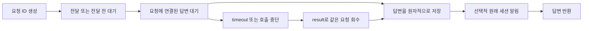

# Architecture decision

- 상태: 채택
- 갱신일: 2026-10-15

## 제품 경계

Wattari Gattari는 Claude Code와 Codex가 소유한 네이티브 세션을 발견하고 연결하는
얇은 로컬 CLI와 선택적인 HTTP 화면입니다. Waga는 provider daemon, 대화 transcript, provider native 승인 UI,
provider 세션을 소유하지 않습니다. 새 세션을 시작하기 전 선택하는 작은 실행 설정
화면은 Waga dock의 입력 계층으로만 동작하며, 실제 승인·샌드박스 집행은 provider에
위임합니다.

- 기본 목록은 모든 프로젝트의 활성 세션이며 `--cwd PATH`로 제한합니다.
- 생성·접속·보관은 provider 공개 CLI 또는 native daemon에 위임합니다.
  새 세션에는 Waga 사용법과 신뢰 경계를 주입하며, 보관은 대화 로그를 영구 삭제하지 않습니다.
- `send`는 단방향, `ask`는 요청에 연결된 답변을 기다립니다. Claude는 busy여도 native
  peer 큐에 넣고 요청 표식이 붙은 답변을 받으면 반환합니다. Codex는 Waga 호출의 로컬
  FIFO를 거쳐 idle에 제출하고, 제출한 turn의 완료·마지막 답변을 확인합니다. 세션 전체의
  idle은 질의 완료 조건이 아닙니다. `--until-idle`은 기존 호출 호환용으로만 허용하고
  추가 대기를 하지 않습니다. Claude의 native turn 완료 여부는 여전히 보장하지 않습니다.
- peer 메시지는 사용자 지시·승인이 아닌 불신 입력입니다. 기존 sandbox·승인 정책을
  유지하며 자동 작업 배정은 하지 않습니다. 명시적인 `ask --notify-origin`은 Claude Code
  호출 세션에 연결된 답변 알림 한 건만 보내며, 그 알림에서 다시 peer 교환을 시작하지
  않습니다. 그 밖의 자동 릴레이는 하지 않습니다. `Alt+N` 새 세션은 선택적인
  별도 `local-llm-router` 프로젝트에서 모델·추론 레벨을 받아 provider에 전달할 수
  있지만, Waga 코어가 개인 정책·GitLab 인증·이슈 저장소를 소유하지는 않습니다. `Alt+D` 새 세션은
  라우터를 호출하지 않고 provider 기본값으로 생성해, 조회 실패를 기다리지 않는 경로를 남깁니다. 사용자가 요청한 조회 자료 재사용은
  v2 스냅샷을 불신 자료로 표시해 새 세션 입력에 한 번 첨부하며, 별도 저장하지 않습니다.
  기존 세션을 감시하거나 턴마다 모델을 교체하지 않습니다. `Alt+S` 실행 설정 화면은
  Claude의 permission mode·실행 플래그와 Codex의 approval policy·sandbox·reviewer·
  summary·세부 승인 항목을 provider별로 라디오/체크박스로 편집합니다. 저장된 값은 새
  세션 생성 시 각 provider 공개 경계로 전달합니다. Codex `Alt+Y`는 이 설정의
  approval policy와 sandbox를 기본값↔YOLO로 빠르게 바꾸는 호환 단축키입니다. YOLO를
  선택하면 App Server `thread/start`와 첫 `turn/start`에 각각
  `approvalPolicy=never`, `sandbox=danger-full-access`와
  `sandboxPolicy={type:dangerFullAccess}`를 전달합니다. 기존 Codex 세션은 F4 재접속 시
  같은 owning daemon의 같은 스레드에 remote TUI가 먼저 resume되도록 하고, 해당 창의
  스레드 제목과 입력 화면으로 attach 완료를 확인합니다. 이어서 `thread/settings/update`로
  다음 턴 설정을 적용하고 `thread/resume`의 유효 승인·샌드박스 응답을 검증한 뒤 창을
  선택합니다. attach나 설정 검증이 실패하면 F4는 실패하고 Dock에 오류를 표시합니다. 기본 모드는
  `config/read`의 현재 기본 정책을 명시적으로 적용합니다. peer `send`·`ask`에는
  Dock의 실행 모드를 적용하지 않습니다.

## 요청 상태와 복구

### 로컬 웹 화면

`waga serve`는 기존 bridge의 목록·preview·create·instruct·ask·result를 호출하는 HTTP 화면입니다.
loopback `127.0.0.1`만 지원하며 실행마다 새 비밀 접속 링크를 발급합니다. 비밀값은 URL fragment로
전달한 뒤 주소에서 제거하고, 동일 origin의 JSON 인증 요청으로 HttpOnly·SameSite=Strict
쿠키를 설정합니다. API는 쿠키를 요구하고 Host를 검증하며, 변경 요청은 정확한 Origin을 요구합니다.
정적 화면은 별도 의존성·빌드 없이 패키지에 포함하고 provider 출력은 텍스트로만 렌더링합니다.

웹 새 작업은 지정 cwd와 provider 기본 모델·정책으로 생성하고 LLR을 호출하지 않습니다.
두 제공자 모두 대화 화면 하단의 한 입력창에서 후속 지시를 보냅니다. 작업 중에도 입력을
막지 않고 네이티브 프런트엔드의 추가 입력·큐 동작을 그대로 사용합니다. 별도 입력 모달이나
고정 숫자·방향키 버튼은 제공하지 않습니다. Claude `attach` 또는 Codex owning daemon의
`resume --remote` 프런트엔드를 node-pty와 xterm.js로 연결하되 평상시 터미널 화면은 숨깁니다.
xterm이 ANSI를 해석한 화면에서 실제 fixture로 확인한 승인 질문과 번호 선택지를 읽어 대화
하단의 버튼으로 표시합니다. 선택 시 현재 질문을 다시 대조하고 해당 번호와 Enter를 전달하며,
선택을 자동 승인하거나 임의의 Yes/No 번호로 치환하지 않습니다. 인식하지 못한 추가 질문은
같은 대화 안에서 원본 입력 화면을 표시합니다. 설정 변경이나 네이티브 세션 생성은 하지 않습니다.
인증 후 최초 선택된 세션과 사용자가 새로 선택한 세션만 연결하며 폴링으로 재연결하지 않습니다.
선택 변경·브라우저 종료 시 웹 프런트엔드만 닫고 백그라운드 세션은 유지합니다.
같은 세션의 동시 웹 조작은 거부하고 전체 웹 프런트엔드는 최대 2개로 제한합니다.
WebSocket에도 정확한 Host·Origin·인증 쿠키와 10초 유효 일회용 연결표를 모두 요구합니다.

기존 `/api/instruct`는 Codex 공식 App Server `turn/start` text input의 호환 경로로 유지합니다.
CLI `send`·`ask`와 호환 HTTP `/api/query`는 peer 신뢰 경계를 유지하며 클라이언트의 임의
source/trusted 필드로 사용자 입력으로 승격하지 않습니다. 웹의 직접 조작은 peer API를 사용하지 않습니다.
수동 작업 묶음과 5단계 화면은 제공하지 않습니다. 서버와 provider 세션의 수명은 분리됩니다.

목록·선택 대화는 5초 캐시하며 동시 동일 조회를 합칩니다. 미리보기는 20개 identity로 제한합니다.
동시 웹 작업은 최대 2개, 완료 작업은 최근 100개, 작업별 진행 이벤트는 최대 40개입니다.
HTTP 응답은 작업 접수 후 반환하고 브라우저 연결 종료는 native 작업을 취소·재전송하지 않습니다.
같은 서버 실행 중 최근 100건 보관 범위의 작업 UUID 중복 제출은 기존 접수 결과를 반환합니다. 재시작을 넘는 웹 UUID
중복 방지는 보장하지 않으며, 네트워크 오류를 자동 재시도하지 않습니다.

요청·답변 복구의 기준은 CLI와 공유하는 RequestStore입니다. 서버의 웹 작업 이력은 메모리에만
보관합니다. 기존 WorkflowStore 파일과 HTTP API는 호환을 위해 유지하지만 UI에서 조회·편집하지
않습니다. 수동 기록은 실제 실행 관계나 검증 결과를 뜻하지 않습니다. 실제 실행 그래프는 RunStore와
provider trace만 사용하며 아래 실행 계약을 따릅니다.

"/api/sessions/:id/messages"는 발견된 정확한 native identity에 대해서만 대화를 페이지 조회합니다.
Codex는 "thread/items/list"의 원래 cursor와 항목 ID를 유지하고 사용자·assistant text를 표시합니다.
Claude는 기존 역방향 JSONL 스캐너를 재사용하여 한 페이지 50개 메시지·최대 4MiB를 읽습니다.
Claude cursor는 파일 identity와 위치에 연결하며 교체·축소 후에는 거부합니다. 도구 결과·meta·sidechain은
대화에서 제외하고 건너뛴 손상·초대형 항목은 표시합니다. 미리보기의 4,000자 제한은 대화에 적용하지 않습니다.

브라우저는 위로 스크롤할 때 이전 대화를 앞에 붙이고 스크롤 위치를 보존합니다. native 항목 ID로
병합해 폴링·페이지 겹침으로 인한 중복을 막으며 동일 문장의 별도 native 턴은 유지합니다.
완료 웹 요청은 native turn ID로 겹침을 제거하고 아직 기록되지 않은 입력·답변만 임시 표시합니다.
기본 탐색은 프로젝트 폴더별 세션 목록이며 대화와 실행 흐름은 같은 선택 identity를 공유합니다.
웹의 폴더 키는 dock과 같은 `projectCwd || cwd`의 절대 경로입니다. 행 드래그 앤 드롭과 Shift+방향키는
같은 폴더의 현재 검색·필터 결과 사이에서만 이동하고 숨겨진 세션을 삭제하지 않습니다.
순서는 dock의 `DockOrderStore`와 공유하며 상태 갱신으로 다시 정렬하지 않습니다.
이름 변경·보관은 bridge의 native 제공자 동작을 사용하고 작업 중인 세션의 보관은 거부합니다.
터미널 연결은 기존 native launcher에서 명령만 조회하며 daemon 시작·설정 변경·실행을 하지 않습니다.
새 세션의 폴더는 서버 기본 폴더 또는 발견한 프로젝트 폴더만 선택할 수 있습니다.
실행 흐름은 해당 폴더의 저장 기록 중 native 세션 ID가 명시적으로 일치하는 기록만 보여주며,
기록이 없을 때 작업 단계나 세션 간 연결을 생성하지 않습니다. 실행 근거는 노드를 선택할 때만 엽니다.

대화 캐시는 최대 20개 identity이며 전체 transcript를 Waga 디스크에 복제하지 않습니다.
초안은 정확한 수신 세션별로 localStorage에 저장합니다. 기록 없는 출처·역할·토큰 수는 추정하지 않습니다.

### 명시적 로컬 워크플로 실행

`waga run workflow.json`만 실행기를 시작합니다. 신뢰하는 로컬 명세의 작업·검사 argv와
입출력을 읽고 작업마다 별도 git worktree에서 공식 Claude CLI를 순차 실행합니다.
기존 peer 메시지·imported trace·웹 명세 등록 자체는 실행 권한이 아닙니다. Claude Workflow
스크립트의 파일·프로세스 접근 제한 때문에 로컬 코디네이터가 결정적 검사와 자원 감시를 맡습니다.
모델 역할 기본값은 plan=opus, scan=haiku, edit/verify=sonnet이며 전역 설정은 변경하지 않습니다.

작업의 통과 조건은 작업자 성공, 검사 종료 코드 0, 별도 native 세션의 독립 검증 pass,
검증 중 산출물 불변입니다. 검증한 SHA-256과 같은 선행 산출물만 전달합니다. 통과한 작업은
재실행하지 않으며 같은 산출물로 두 차례 수정에도 실패하면 재계획 상태로 멈춥니다.
전부 통과해도 최종 검토 대기이며 웹의 완료 기록은 배포·머지·원본 적용을 실행하지 않습니다.

`RunStore`는 실행·회차·자원·native 세션·정규화 span을 비공개 파일에 보관합니다.
실행별 bearer는 해당 실행의 이벤트·trace에만 접근하며 웹 제어는 쿠키·정확한 Origin을 요구합니다.
완료·수정 진행 상황은 호출 span과 분리합니다. 명시된 입출력만 데이터 의존성이고 native 호출
부모는 호출 관계입니다. 기존 Codex 세션은 목록·질의 경로를 유지하며 자동 실행·실시간 span
생성을 제공한다고 주장하지 않습니다. 운용·복구 한계는 [실행 문서](../web-executions.md)에 둡니다.

표준 Node 검증은 테스트 파일을 하나씩 실행하여 대량 병렬 worker 생성을 막습니다.

### CLI 요청 기록

CLI는 요청 ID·대상·전달 상태·native turn/message ID 및 회수한 답변 한 건만 개인 상태
디렉터리에 기록합니다. 요청 본문·전체 transcript·실행 daemon은 소유하지 않습니다.
`result`는 재전송 없이 원래 turn 또는 Claude의 명시적 요청 표식을 읽습니다.
원래 turn의 중단은 다른 turn을 따라갈 근거가 아니며 결과 미확정으로 남깁니다.
답변 수신 시 알림·호출 반환보다 먼저 답변을 원자적으로 고정하여 중단이나 재조회가
답변을 숨기거나 다른 답변으로 바꾸지 않습니다. 일반 출력과 JSON은 같은 완료 조건을
사용합니다. 오래된 Claude `reply-received` 기록의 답변도 현재 세션 상태와 무관하게
회수합니다. Codex의 진행 문장은 답변으로 고정하지 않습니다.
Codex가 제출 직후 같은 turn을 일시적으로 `interrupted`로 표시해도 답변 제한 시간까지
그 turn만 재조회합니다. 정상 완료로 바뀌면 최종 답변을 회수하고, 중단이 지속되면 실패로
반환합니다. 재전송이나 다른 turn의 답변 회수는 하지 않습니다.

Claude의 단방향 `send`는 짧은 native 접수 확인 이후 반환합니다. `result`는 정확한 세션·
요청 ID의 native 큐 접수를 `receipt=queued`, 원래 message ID의 `queued_command` 대화
첨부를 `receipt=consumed`로 회수·저장합니다. 큐 제거만으로 대화 편입을 추정하지 않으며,
접수·대화 편입은 이해·작업 완료·승인을 뜻하지 않습니다. 별도 ACK 요청이나 릴레이는 없습니다.

### 질의 완료 계약

`ask`의 완료 단위는 한 요청입니다. Claude는 정확한 대상·요청 표식의 peer 답변,
Codex는 제출 시 확보한 `turnId`의 완료 답변을 사용합니다. 접수 확인은 답변이 아니며,
답변 후 상대가 다른 작업을 계속하거나 승인·입력을 기다리는 상태는 회수를 지연시키지
않습니다. 작업 완료를 묻는 요청에는 peer가 그 작업 결과를 답해야 합니다. Waga가 세션
전체의 idle로 그 의미를 추정하지 않습니다.

timeout·중단은 원격 실행 취소나 미전송을 뜻하지 않습니다. 요청 ID·전달 상태를 보존하고
재전송 없이 `result`로 확인합니다. 저장된 답변은 peer 상태 조회 없이 반환합니다.
전달 전 대기는 Codex의 공개 제출 경계 때문에 유지하지만, 전달 후 세션 idle 대기는
없습니다. 예전 `--until-idle` 호출과 Claude `reply-received` 기록에도 같은 계약을 적용합니다.

2026-09-10 설치된 Codex 0.154.0 `generate-ts --experimental` 스키마에서
`ThreadQueueAddParams`는 `threadId`, `input: UserInput[]`, `clientUserMessageId`만 받으며
`toolOutput`을 받지 않습니다. peer를 사용자 입력으로 승격하지 않기 위해 native queue
API를 사용하지 않습니다. 로컬 FIFO는 같은 상태 디렉터리의 Waga 프로세스끼리만 조정하며
외부 클라이언트의 동시 입력은 막지 못합니다. 접수 순서는 단일 append로 정하고,
PID와 시작 시각이 일치하는 살아 있는 호출만 대기열을 점유합니다.
호출이 죽으면 기록은 남지만 다른 호출이 그 본문을 대신 제출하지 않습니다.

Claude 요청에는 `SendMessage` 도구와 호출자의 `uds:` 회신 주소를 명시합니다.
reply socket은 호출 동안만 유지됩니다. 호출 중에도 정확한 세션의 native JSONL에서
전송 직전 파일 크기 이후에 추가된 요청 표식의 답변을 읽어, 화면에만 답한 경우를 회수합니다.
소켓과 로그 중 먼저 받은 답변 한 건으로 완료하며, 대기가 끝나면 로그 조회도 중단합니다.
종료 후 복구는 해당 native JSONL의
assistant text 또는 원래 socket으로 보내는 SendMessage 본문에 있는 요청 표식에 한정합니다.
답변 표식은 모델이 생성하므로 누락 가능하며, 누락을 성공이나 다른 답변으로 대체하지 않습니다.
자세한 상태·종료 코드·시간 제한은 [README](../../README.ko.md#세션-간-메시지)를 따릅니다.

## Provider 경계

- Claude: `claude agents --json`, native peer Unix socket, `claude --bg`,
  `claude attach`, `claude rm`을 사용합니다.
  JSON 목록에 섞인 `interactive` 항목은 제외하고 attach 가능한 background 세션만 연결합니다.
- Claude 생성 시 실행별 `--settings`에 제목 훅을 추가합니다. 시작 훅은 기능을 등록하고,
  `UserPromptSubmit`은 UUID별 이름 변경 요청을 한 번 전달합니다. 전달 전에는 대기 이름,
  전달 후에는 native 목록 이름을 표시합니다. 전달은 적용 확인이 아니므로 실패 시 F2로
  재요청합니다. 훅 없는 세션은 로컬 별칭입니다. 전역 설정·로그 수정이나 추가 모델 호출·폴링은 없습니다.
- Codex: 기존 native App Server daemon의 Agents 소유 최상위 세션만 사용하며,
  세션 생성·resume·archive와 메시지 전달도 그 daemon에 위임합니다. 일반 CLI나
  VSCode 대화 기록은 dock에 섞지 않습니다.
- Codex 화면은 `--remote`로 owning daemon의 원래 스레드에 붙습니다. remote CLI argv의
  권한 플래그는 0.155.1에서 `Permission overrides are not supported when resuming a remote task.`로
  거부됐습니다(2026-09-22 실측). 0.156.0 생성 App Server 스키마에는
  `thread/settings/update`의 `approvalPolicy`·`sandboxPolicy`와 `thread/resume`의 유효
  `approvalPolicy`·`sandbox`가 있습니다(2026-09-23 실측). F4는 이 공식 경계로 권한을
  새 TUI의 resume 이후 적용·검증하고, RPC 미지원·값 불일치·스레드 누락이면 화면 전환 전에 오류를 표시합니다.
  `null` 설정은 기존 YOLO를 되돌리지 않았으므로 기본 모드도 명시적인 설정 변경입니다.
- Dock 목록은 provider별로 독립 갱신합니다. 한쪽 조회가 대기 중이어도 다른 쪽은 계속
  갱신하며, 같은 provider의 조회는 중복 실행하지 않습니다. 미조회·오류 provider의 기존
  세션과 경고는 유지하고, 해당 provider의 성공한 조회에서 두 번 누락된 세션만 제거합니다.
  불완전한 Codex 목록을 삭제로 취급하지 않습니다.
- 사용량은 Claude OAuth usage endpoint·Codex App Server에서 읽어 5분 캐시합니다.
  Codex 사용량은 별도 연결에서 조회하며 목록 응답을 지연시키지 않습니다. 조회 실패는 세션 발견에 영향을 주지 않습니다.
- RPC 제출 확인 timeout은 전달 여부 불명으로 취급하며 자동 재전송·원격 작업 중단을 하지 않습니다.
- 새 세션 생성 전에 외부 라우터가 실패하면 provider 기본값으로 한 번만 계속하며,
  라우터가 이슈 본문·라벨·코멘트를 읽더라도 그 내용은 라우팅 근거로만 취급합니다.
  호출 인자와 v1 JSON 응답은 [local-llm-router 입출력 계약](2026-09-09-local-router-contract.md)을 따릅니다.

## Dock backend

Dock은 세션 목록과 관리를 담당합니다. 대화·도구·승인·모델 실행과 native 화면은
provider가 소유합니다. 사용법과 단축키는 [README](../../README.ko.md)에 둡니다.
새 세션 provider 실행 설정은 `$XDG_CONFIG_HOME/wattari-gattari/settings.json` version
2에 저장하고, version 1 Codex 전환 값은 읽을 때 변환합니다. 파일이 없거나 읽히지
않으면 provider 기본값으로 닫힙니다. Waga는 provider 승인 UI를 대신 소유하지 않고,
저장한 선택을 생성 시 provider 공개 인자로 전달할 뿐입니다.

- 생성 직후에는 해당 provider에서 새 native ID의 실제 정보를 확인해 먼저 표시하고 입력을 해제합니다.
  전체 목록은 백그라운드에서 갱신하며, 생성 확인 후 메타데이터 조회 실패는 생성 실패로 취급하거나 재전송하지 않습니다.
- 보관은 native 성공 확인 후 즉시 행을 제거하고 입력을 해제합니다. 창 정리·전체 목록 갱신은
  뒤에서 진행하며, 늦은 목록이 보관된 행을 복원하거나 종료된 dock을 다시 그리지 않습니다.

- 오른쪽 미리보기는 선택한 세션의 마지막 입력·응답을 읽기 전용으로 표시합니다.
  Codex는 `thread/items/list`를 최대 3페이지·페이지당 50항목, Claude는 해당 UUID의
  JSONL을 256KiB씩 뒤로 읽어 마지막 입력·응답을 찾고, 이후에는 추가된 부분만 읽습니다.
  도구 출력·사고 내용과 4MiB 초과 레코드는 제외하며 조회 범위 제한을 표시합니다.
  선택 debounce 150ms, 메모리 캐시 5초·최대 20세션, 입력·응답 각각 4,000자로 제한합니다.
  숨긴 dock·좁은 화면에서는 조회하지 않으며 별도 transcript 저장·모델 호출·daemon 기동은 없습니다.
  경로 변경은 즉시 재조회하고, 일시적 실패는 원인과 마지막 성공 시각을 표시하며 기존 내용을 유지합니다.
  넓은 화면의 응답 영역은 `PgUp`·`PgDn`으로 선택 세션을 유지한 채 페이지 스크롤하며,
  세션을 변경하면 처음 위치로 돌아가고 같은 세션의 자동 갱신에서는 현재 위치를 유지합니다.

- 새 세션 프롬프트는 여러 줄을 보존하고 Shift+Enter/입력 LF/Ctrl+J로 개행,
  Enter로 생성합니다. ↑↓·Home·End는 논리 줄 기준으로 이동하며 최대 5줄을 표시합니다.
  입력 중 Alt+P로 폴더 탐색창을 열고, 선택한 기존 폴더를 생성 요청의 cwd에 전달합니다.
  탐색창의 e 키는 직접 경로 입력으로 전환합니다.
  생성 중 중앙 모달은 bridge의 모델 선택·provider 생성 요청·접수 후 목록 조회 이벤트와
  경과 시간을 표시합니다. LLR 진행 이벤트를 지원하면 이슈 조회·판정 대기를 표시하고,
  최종 모델·추론 강도·등급·확신도·판정 사유·경고를 줄바꿈하여 표시합니다.
  판정 사유를 규칙 사유보다 먼저 보여주며, 작은 화면은 상세 일부를 생략합니다.
  임의 진행률은 사용하지 않으며 실패 시 원문 편집기로 복귀합니다.
- `auto`는 tmux가 있으면 `tmux`, 없으면 `direct`를 선택합니다.
- `tmux` 진입마다 별도 `waga-view-<uuid>` session과 overview 프로세스를 생성합니다.
  목록 선택·미리보기·현재 window는 터미널별로 독립적입니다. tmux 밖에서는 격리 server를,
  tmux 안에서는 현재 server를 사용해 중첩 tmux를 피합니다. 기존 공통 dock은 재시작하지 않습니다.
- 네이티브 TUI는 제공자 포함 세션 ID의 SHA-256으로 이름 붙인 `waga-retained-<hash>`
  session에 하나씩 보관하고 `link-window`로 각 화면에 연결합니다. 같은 server 내 동시 생성은
  tmux의 session 이름 유일성으로 중복 실행을 막습니다. 초기화 중인 창은 재접속하지 않습니다.
  다른 server 사이에는 창을 공유하지 않습니다.
- 창 선택과 Agents View 호출은 호출한 화면의 session을 명시합니다. 단순 session group은
  overview 프로세스까지 공유하므로 사용하지 않습니다. 한 터미널의 종료·연결 해제는 해당
  overview와 링크만 정리하며, 보관된 TUI는 다음 진입에서도 재사용합니다.
- 보관 창의 Codex frontend는 실제 client가 해당 window를 보고 있을 때 시작합니다.
  host가 `window_active_clients`를 확인하며, dock은 화면 안정화 대기보다 먼저 창을 연결·선택합니다.
  시작 시 터미널 배경색 조회가 숨겨진 창에서 실패한 채 캐시되는 경로를 피합니다.
  30초 동안 표시되지 않거나 조회가 실패하면 Codex를 시작하지 않고 오류를 남깁니다.
  이미 실행 중인 frontend의 색상 캐시는 바꾸지 않습니다.
- 같은 에이전트 창을 동시에 보면 화면·입력·TUI 스크롤은 공유됩니다. 창 크기는 최근 활성
  client를 따릅니다. 다른 terminal에 표시 중인 창은 자동 재접속하지 않고, 강제 재접속은
  `TMUX_VIEW_IN_USE`로 거부합니다. 다른 화면을 dock으로 돌린 뒤 재접속할 수 있습니다.
- RGB 전달을 설정한 Waga 격리 tmux server에서는 Claude 세션·Agents View 실행에만
  `CLAUDE_CODE_TMUX_TRUECOLOR=1`을 전달해 Claude의 기본 256색 제한을 해제합니다.
  기존 사용자 tmux server와 Codex 실행 환경에는 추가하지 않습니다.
- Claude 창은 선택 시 Linux `/proc`의 frontend 명령이 요청한 `attach`와 일치하는지 확인합니다.
  native Agents View로 이동했거나 식별할 수 없으면 해당 창만 재접속합니다. 주기적 감시는 없습니다.
- Codex 창은 실행별 `tui.terminal_title=["thread-id"]`와 선택 시 화면 상단 두 줄로 식별합니다.
  0.153.2의 UUID 29자+`...` 제목은 알려진 목록과 접두사 충돌 시 확인 불가로 취급합니다. 제목은 재사용
  힌트일 뿐 메시지 대상은 항상 전체 ID입니다. 전역 설정과 transcript는 수정하지 않습니다.
  화면은 같은 세션·다른 세션·확인 불가로 구분합니다. 조회가 성공하고 `Agent command center`나
  다른 세션 ID가 확인된 경우 재접속합니다. 제목 미확정·조회 실패·빈 응답에서는 살아 있는
  화면을 유지해 진행 중인 복원을 끊지 않습니다. 필요하면 F4로 명시적으로 재접속합니다.
- 종료된 창과 강제 재접속은 선택한 세션의 `attach`/`resume`으로 frontend를 교체합니다.
- 격리 tmux server의 `Alt+A`는 세션 window와 분리된 provider Agents View를 열고,
  `Alt+G`는 Dock으로 돌아갑니다.
- Waga session에만 mouse mode를 적용합니다. provider가 휠을 처리하면 전달하고,
  아니면 tmux scrollback을 사용합니다.
- `direct`는 현재 terminal을 네이티브 TUI에 넘긴 뒤 detach 또는 종료 시 dock을
  복원합니다. window 재사용, 공통 복귀 키와 화면 공유는 제공하지 않습니다.

tmux는 화면 배치와 전환만 소유합니다. provider daemon, 세션, transcript와 작업은
Waga dock 또는 tmux window의 수명과 독립적입니다.

진단 이벤트는 세션 ID·loaded 목록 변화·tmux 창 조작·화면 식별 결과와 조회 종료 코드·native TUI 종료 결과만 기록하며
프롬프트와 transcript는 제외합니다. 30일 보관용 logrotate·timer 설정은 [integrations](../../integrations/)에 둡니다.

## 변경 검증

`관측 → 최소 재현 → 가설 → 계측 → 수정 → 회귀 테스트`로 진행합니다.
파서·어댑터는 실제 출력 fixture로, 실제 provider는 이름·작업 디렉터리가 `waga-proof-*`인
폐기용 세션으로만 검증합니다. 명령과 결과 해석은 [테스트 절차](../testing-plan.md)를 따릅니다.
최종 tree에서 예상 밖 staged·untracked 파일과 완료된 TODO를 정리하고 미검증 런타임을 명시합니다.

`git push`, npm 배포, 사용자 전역 설정 변경과 기존 세션 조작은 별도 사용자 요청이
있을 때만 수행합니다.
